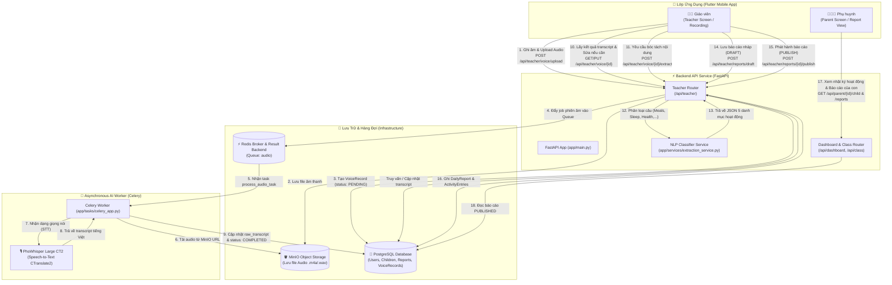
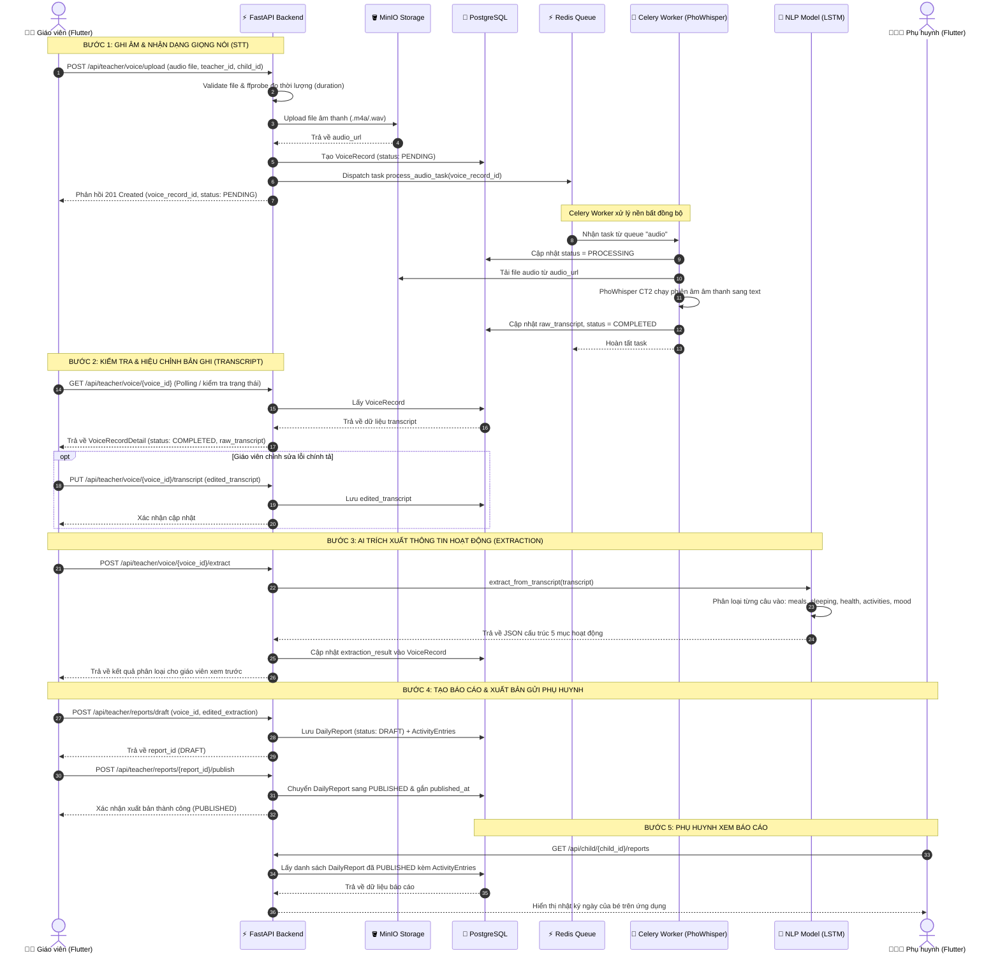

# KinderLog - Hệ Thống Sổ Liên Lạc Điện Tử Mầm Non Thông Minh

KinderLog là giải pháp hỗ trợ giáo viên mầm non ghi nhận nhật ký hoạt động hàng ngày của trẻ thông qua giọng nói, tự động chuyển đổi thành văn bản (Speech-to-Text với **PhoWhisper**) và phân loại ngữ nghĩa (NLP **LSTM Classifier**) để tạo báo cáo ngày gửi tới phụ huynh.

---

## 1. Sơ đồ Kiến trúc & Luồng hoạt động Tổng thể (Architecture Flowchart)

---

## 2. Sơ đồ Tuần tự Luồng Nghiệp vụ Chi tiết (Voice-to-Report Sequence Diagram)

---

## 3. Các Thành phần Công nghệ Chính

- **Frontend**: Flutter (Dart) cho cả Teacher App & Parent App.
- **Backend**: FastAPI (Python), SQLAlchemy ORM, Pydantic.
- **AI / Speech-to-Text**: Celery Worker kết hợp **PhoWhisper-large-ct2** (CTranslate2) chạy GPU (CUDA) hoặc CPU fallback.
- **AI / NLP Classifier**: Model LSTM PyTorch (`text_classifier_model.pt`) phân loại câu thành 5 nhóm:
  - `meals`: Ăn uống
  - `sleeping`: Ngủ nghỉ
  - `health`: Sức khỏe, thân nhiệt
  - `activities`: Vui chơi, học tập
  - `mood`: Tâm trạng, cảm xúc
- **Message Broker & Queue**: Redis.
- **Storage**: MinIO (Object Storage) & PostgreSQL 16 (Relational DB).
